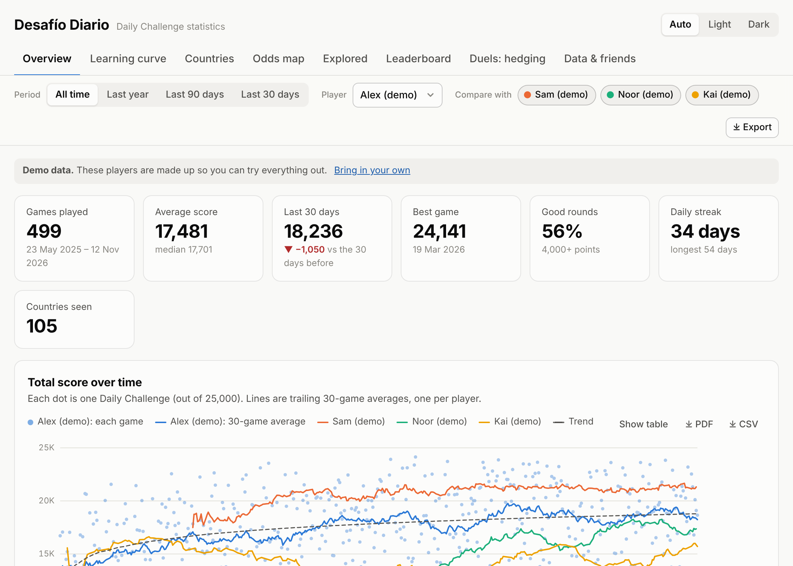
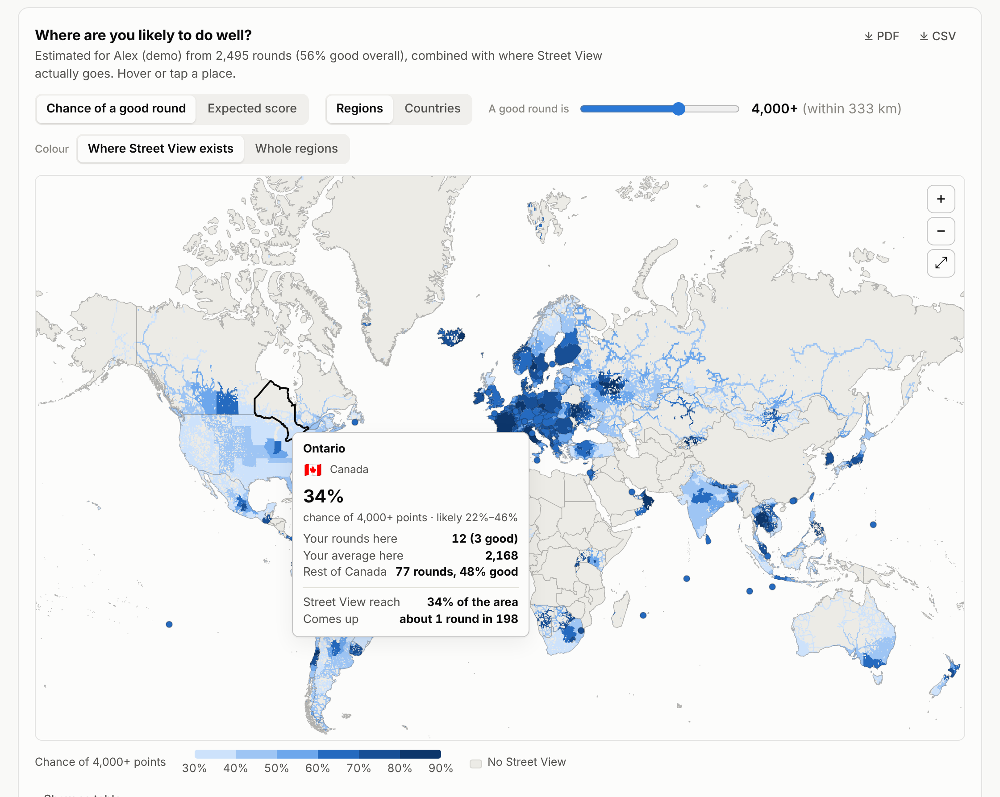
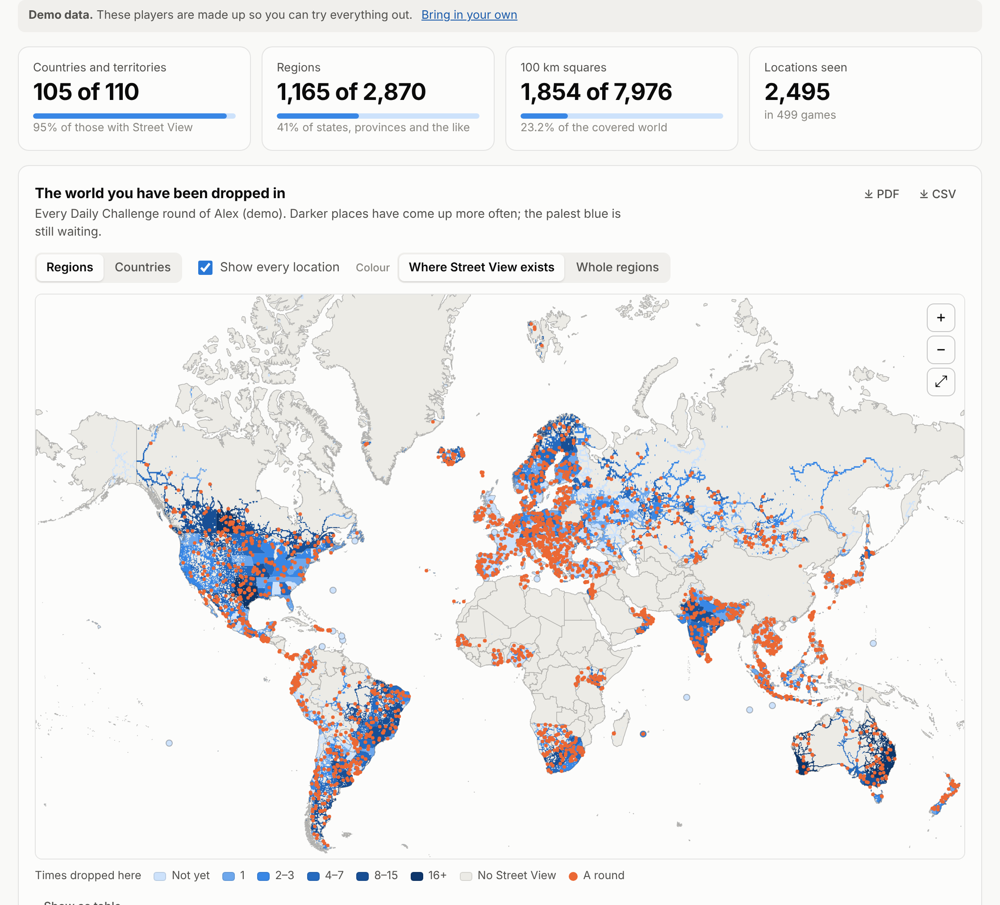
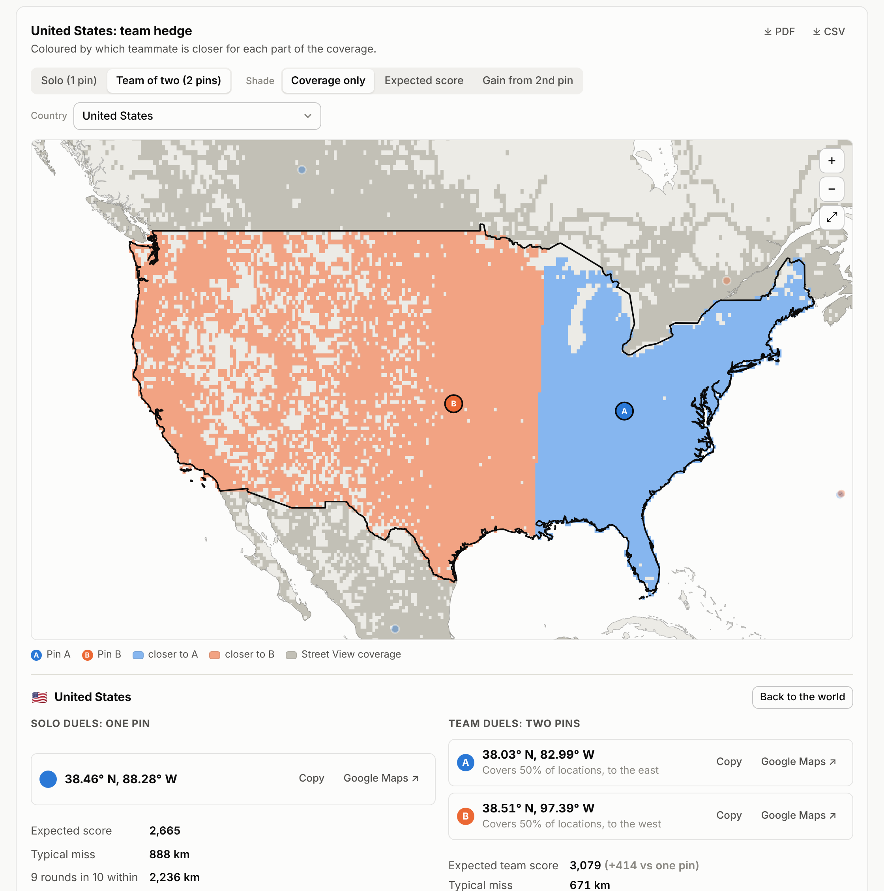

# Desafío Diario

Statistics for the GeoGuessr **Daily Challenge**: your whole history with the five rounds of every game, how you are improving, where in the world you are most likely to score well, how much of the world you have been dropped in, and how you compare with friends.

It is a static web app. Your data stays in your browser; there is no server and no account.









*(Screenshots show the built-in demo players.)*

## What it does

| You asked for | Where it is |
|---|---|
| Every daily challenge score in history, with the five-round breakdown | **Overview** → *Recent games* (a five-cell strip per game: country and score), plus the chart tables |
| Total score over time | **Overview** → *Total score over time* (each game, a trailing average, a fitted trend) |
| Connecting other people's history | **Data & friends**: GeoGuessr friends come along automatically; anyone else can send you their export file |
| Leaderboard over time against friends | **Leaderboard**: standings, days won, 30-day form over time, head-to-head records |
| Heat map of where you are likely to do well, down to regions, using Street View coverage, with probabilities on hover | **Odds map** |
| Scores over time for specific countries | **Countries** → pick a country (round scores, trend, region breakdown) |
| Regression for the learning curve, overall and by country | **Learning curve** |
| Map of how much of the world you have explored | **Explored** |
| Best hedge spot per country for duels, and where two teammates should hedge | **Duels: hedging** |
| Every graph as a PDF, every table and statistic as a CSV | **⤓ PDF / ⤓ CSV** on each chart, map and table, and **⤓ Export** at the top of each page |

## Try it

```bash
npm install
npm run dev        # http://localhost:5173
```

Click **Explore with demo data** to look around with four made-up players, or go to **Data & friends** to bring in your own history.

## Getting your data out of GeoGuessr

GeoGuessr has no export and no public API, and a web page on another site cannot read your GeoGuessr account. So the data is collected *inside your own signed-in GeoGuessr tab* by a small script (the "collector"), and then handed to the app.

1. Open the app's **Data & friends** tab.
2. Drag the **Desafío Diario collector** button to your bookmarks bar (or use **Copy script**).
3. Go to [geoguessr.com](https://www.geoguessr.com/), signed in, and click the bookmark (or paste the script into the browser console).
4. A panel in the corner shows progress. When it finishes, choose **Open in Desafío Diario** (the data arrives in the app, which asks you to confirm) or **Download file** and drop the file into the app.

The first run needs one or two requests per game, about seven a second: a few minutes for a history of several years. The collector remembers what it has fetched (in your browser's storage for geoguessr.com), so later runs only fetch new days; in a test, a repeat run took 12 requests.

What the collector does and does not do:

- It only makes **read** requests, the same ones the GeoGuessr site makes: your profile, your activity feed (to find which challenges were Daily Challenges), the Daily Challenge calendar, and the results of each of those challenges. It cannot start a game or change anything.
- Your session cookie never leaves the GeoGuessr tab. The result goes only to the app that issued the script, or to a file.
- The script is not minified; read it at `collector.js` on your deployment or in [`src/collector`](src/collector).

> **Status of the collector.** GeoGuessr's interface is internal and undocumented. The endpoints and response shapes used here were checked on 12 November 2026 against the live site's public endpoints and its own JavaScript, and the whole flow is tested end to end against a mock server that reproduces those shapes (`npm run mock:geoguessr`). It has **not** been run against a signed-in account, because none was available while building it. If GeoGuessr answers differently for your account, the panel says which step failed; the request logic is in [`src/collector/core.ts`](src/collector/core.ts) and is small.

### Friends

- **GeoGuessr friends**: when you collect your history, the results of your friends on the challenges *you* played are included (that is what GeoGuessr shows you on a challenge's friends leaderboard). They appear as players automatically.
- **Anyone else, or the days a friend played without you**: they run the collector on their own account and send you the downloaded JSON file. Drop it into **Data & friends**. Files merge, so importing things twice is harmless.
- Each player gets a colour that never changes. Pick whose statistics to look at with the **Player** selector, and who to compare against with the chips next to it.

## How the numbers are worked out

### Scores

A round is worth $5000\,e^{-10d/D}$ points for a guess $d$ away, where $D$ is the map's size. The Daily Challenge is played on the World map, $D = 14\,916.862$ km, so

$$s(d) = 5000\,e^{-d / 1491.7\ \text{km}}$$

and a score threshold corresponds to a distance: $4000$ points means within $333$ km. "Good round" throughout the app means a score at or above a threshold you can set on the Odds map (default $4000$).

### Learning curve

Three curves are fitted to your daily totals by least squares, with $t$ the days since your first game and $n$ the number of games played before:

$$\text{straight line: } \hat s = a + b\,t \qquad \text{diminishing returns: } \hat s = a + b\,\ln(1+n) \qquad \text{levelling off: } \hat s = L - G\,e^{-n/\tau}$$

The plateau curve is fitted by scanning $\tau$ on a grid, which makes it linear in $L$ and $G$ and avoids fragile iterative optimisation. Models are compared with $\mathrm{AIC} = N\ln(\mathrm{RSS}/N) + 2(k+1)$; "best fit" keeps a two-parameter curve unless the plateau curve wins by more than 2. The band is the 95% confidence band of the *average* level, and the p-value is an F test against "no change at all".

Per country, the round scores are regressed on time (points per year, with a 95% interval). Because dozens of countries are tested at once, p-values are adjusted with the Benjamini–Hochberg procedure and only trends that survive at a 5% false discovery rate are highlighted.

### Street View coverage

The coverage data is built once by [`scripts/build-geodata.ts`](scripts/build-geodata.ts) from two public sources:

- **Where Street View exists**: the [coverage date maps](https://geo.emily.bz/coverage-dates) maintained by emily, about 7.3 million official Street View locations for every country and territory on Google Maps (newest imagery in this build: November 2025).
- **Boundaries**: [Natural Earth](https://www.naturalearthdata.com/) 1:10m admin-1 (states, provinces and their equivalents; public domain).

Every location is assigned to its region with the full-resolution boundaries. Because the source samples small countries far more densely than large ones, raw point counts are not comparable; instead coverage is measured on a uniform $0.25^\circ$ grid (about 25 km), coarser than the sparsest country's sampling: a cell is "covered" if it contains any location. From that the build derives, per country and per region:

- the covered cells, and the share of the area lying in a covered cell ("Street View reach");
- the country's **best single guess**: the spot that maximises the expected score over the country's Street View locations, and that expected score (the same point as the solo duel hedge, below). This is what knowing the country and nothing else is worth (about 4,930 in Luxembourg, 2,670 in the United States, 2,500 in Russia). For the United States the point lands in southern Illinois, pulled east of the geographic middle by the dense eastern coverage;
- for each region, how far its coverage lies from that point.

Only these aggregates and the low-resolution coverage bitmap are stored in the repository, not the source points.

### Odds map

You meet most regions a handful of times or never, so a raw success rate per region would be noise. The estimate is built in three layers.

1. **A starting point from coverage.** For region $r$ let $g_r$ be the logit of the share of its covered cells within the good-round distance $d_T$ of its country's best single guess, and $f_c$ the standardised log share of rounds that land in its country. A ridge-penalised logistic regression on *your* rounds learns how much each matters for you:

$$m_r = \sigma\!\left(\beta_0 + \beta_1\,g_r + \beta_2\,f_{c(r)}\right)$$

   With fewer than 40 located rounds the slopes stay at zero and every place starts from your overall rate.

2. **The country.** With $s_c$ good rounds out of $n_c$ in country $c$ and $m_c$ the coverage-weighted average of its regions' $m_r$:

$$p_c = \frac{s_c + \kappa_1\,m_c}{n_c + \kappa_1}$$

3. **The region.** The rest of the country shifts the region's starting point (leaving out the region's own rounds so they are not counted twice), and the region's rounds then update it:

$$\operatorname{logit} m'_r = \operatorname{logit} m_r + \operatorname{logit} p_c^{(-r)} - \operatorname{logit} m_c \qquad p_r = \frac{s_r + \kappa_2\,m'_r}{n_r + \kappa_2}$$

The strengths $\kappa_1, \kappa_2$ (how many rounds of evidence the starting point is worth) are chosen by maximising the Beta-Binomial marginal likelihood, capped at 16 and 12 so that no prior outweighs a couple of dozen real rounds. The "likely" range in the tooltip is the 80% credible interval of $\mathrm{Beta}\big(s_r + \kappa_2 m'_r,\; n_r - s_r + \kappa_2(1 - m'_r)\big)$. The expected score is shrunk the same way.

By default the map is coloured only where Street View exists, so a vast region with one covered road does not read as a vast coloured area; "Whole regions" switches that off.

### Explored

Distinct countries, regions and 1° squares (about 100 km) you have been dropped in, each as a share of what Street View covers. Countries count as "in play" when coverage spans at least five grid cells or they have come up in your data.

### Duels: where to hedge

In a duel you often know the country but not the region. The pin for a country is the spot $h$ that maximises the expected round score over where that country's locations fall:

$$h^\star = \arg\max_h \sum_i w_i \, s\big(d(h, x_i)\big), \qquad s(d) = 5000\,e^{-d / 1491.7\ \text{km}}$$

The $x_i$ are the country's Street View locations from the coverage dataset (grouped into cells of $0.05^\circ$ to $0.25^\circ$ for speed, each weighted $w_i$ by how many locations it holds), so dense coverage pulls harder than a lone road. It behaves like a robust centre of the coverage: because a 3,000 km miss and a 6,000 km miss both score next to nothing, far-off outliers (Alaska, the Canary Islands, the Azores) barely move it. The pin may sit in the sea or across a border; GeoGuessr scores any click by its distance.

In **team duels** a team scores its best guess each round, so two teammates should split the country. The pair of pins maximises the expected value of the *better* of the two scores:

$$(a^\star, b^\star) = \arg\max_{a,\,b} \sum_i w_i \, \max\big(s(d(a, x_i)),\ s(d(b, x_i))\big)$$

Each teammate then covers the locations closer to their pin (the map colours the two halves when you pick a country). Neither problem has a single peak, so the optimiser screens a few hundred candidate spots, polishes the best with a pattern search (and, for pairs, alternates between the two pins from several starts), and keeps the best result. In the United States the solo pin expects 2,665 points; two pins (in Kansas and in eastern Kentucky) expect 3,079.

Assumptions: within a country, locations follow Street View coverage; the country is known for certain; scoring is the World map's (smaller maps fall off faster, which pulls pins towards the densest coverage). The section works without any imported data.

### Exports

Every chart has **⤓ PDF** (an A4 landscape page with title, legend, player and period, the chart as vector graphics, and sources) and **⤓ CSV** (the numbers behind it, the same as its *Show table* view). Maps export as high-resolution images in a PDF with their colour scale. Tables export as CSV with raw numbers (ISO dates, plain numbers, percentages as numbers) and include columns that are only in the export, such as coordinates and confidence bounds. The **⤓ Export** button at the top of each page lists everything on it, including the summary tiles, and can download it all as one ZIP. PDFs always use the light colours, whatever theme you view the app in, and embed the DejaVu Sans font so accented and non-Latin names print correctly.

### Leaderboard

Averages, medians and best games per player; **days won** (top score among the compared players, on days at least two of them played); a trailing 30-day average over time; and head-to-head records on shared challenges. "Only days everyone played" restricts everything to the challenges all compared players took part in.

## Deploying

The build is a folder of static files with relative paths, so it works anywhere, including a GitHub Pages project site.

```bash
npm run build      # output in dist/
```

A workflow is included ([`.github/workflows/deploy.yml`](.github/workflows/deploy.yml)): it runs the tests, builds, and publishes to GitHub Pages, when started by hand or on a push to `main`. To use it, enable Pages once in the repository settings (**Settings → Pages → Source: GitHub Actions**), then start it from the **Actions** tab (**Build and deploy → Run workflow**).

The bookmarklet and the "Open in Desafío Diario" button point at wherever the app is being served from, so friends can use your deployment with their own data; nothing is shared between visitors.

## Development

```bash
npm test                  # unit tests (numerics, region lookup, dataset handling, the collector against a mock)
npm run typecheck
npm run mock:geoguessr    # a local stand-in for geoguessr.com, to try the collector end to end
npm run build:geodata -- --download   # rebuild public/data from the sources (downloads about 700 MB)
```

To try the full collection flow locally: run `npm run dev` and `npm run mock:geoguessr`, open the mock page it prints, and run the collector there as you would on GeoGuessr.

```
src/collector/   the script that runs on geoguessr.com (core.ts is environment-agnostic and tested)
src/data/        export format, merging, derived series, demo players, browser storage
src/geo/         boundaries, region lookup, Mercator
src/stats/       regressions, the odds model, duel hedges, country statistics, leaderboard, exploration
src/export/      CSV, ZIP and PDF export (the PDF code loads only when used)
src/charts/      SVG charts with crosshair tooltips and table views
src/map/         the canvas world map
src/views/       one file per tab
scripts/         geodata pipeline, collector bundling, mock GeoGuessr
public/data/     generated geodata (regions, coverage statistics, coverage bitmap, duel hedges)
public/fonts/    DejaVu Sans (subset) for PDF text, with its licence
```

`node scripts/run-ts.mjs scripts/dev/eval-lookup.ts <sample.json>` measures how well the simplified boundaries shipped to the browser reproduce the full-resolution assignment (the sample comes from `npm run build:geodata -- --sample-out <file>`). In this build 99.7% of 183,000 sampled Street View locations resolve to the same region.

### Export file format

Plain JSON, so other tools can produce or consume it:

```jsonc
{
  "format": "desafio-diario", "version": 1, "exportedAt": "…", "source": "geoguessr",
  "owner": { "id": "…", "nick": "…", "countryCode": "ES" },
  "players": [ { "id": "…", "nick": "…" } ],
  "challenges": [ {
    "token": "…", "date": "2026-11-11", "map": "world", "timeLimit": 180,
    "rounds":  [ { "lat": 48.1, "lng": 11.5, "cc": "DE" } /* × 5 */ ],
    "results": [ { "playerId": "…", "total": 21345, "totalTime": 240, "playedAt": "…",
                   "guesses": [ { "lat": 48.3, "lng": 11.2, "score": 4871, "distance": 38650, "time": 41 } /* × 5 */ ] } ]
  } ]
}
```

## Limits worth knowing

- The collector depends on GeoGuessr's internal interface, which can change without notice (see the status note above).
- Running the collector needs a desktop browser.
- When GeoGuessr does not report a challenge's date, the app uses the earliest time any player in your data started it (Daily Challenges run on UTC days).
- Region statistics rely on simplified boundaries: about 0.3% of locations near a border are credited to a neighbouring region.
- Coverage is a snapshot; rebuild the geodata to refresh it.
- Duel hedges assume locations follow Street View coverage within a country; GeoGuessr's own map distributions are not public.
- Everything is stored in the browser you use. Use **Backup → Download everything** before clearing site data or switching browsers.

## Credits

Street View coverage from [emily's coverage date maps](https://geo.emily.bz/coverage-dates). Boundaries from [Natural Earth](https://www.naturalearthdata.com/). PDF text in [DejaVu Sans](https://dejavu-fonts.github.io/) (licence in `public/fonts`). Response-shape notes from the community's [py-geoguessr](https://github.com/miss-inputs/py-geoguessr).

This is an unofficial fan project. It is not affiliated with or endorsed by GeoGuessr, and "GeoGuessr" and "Street View" are trademarks of their respective owners.
